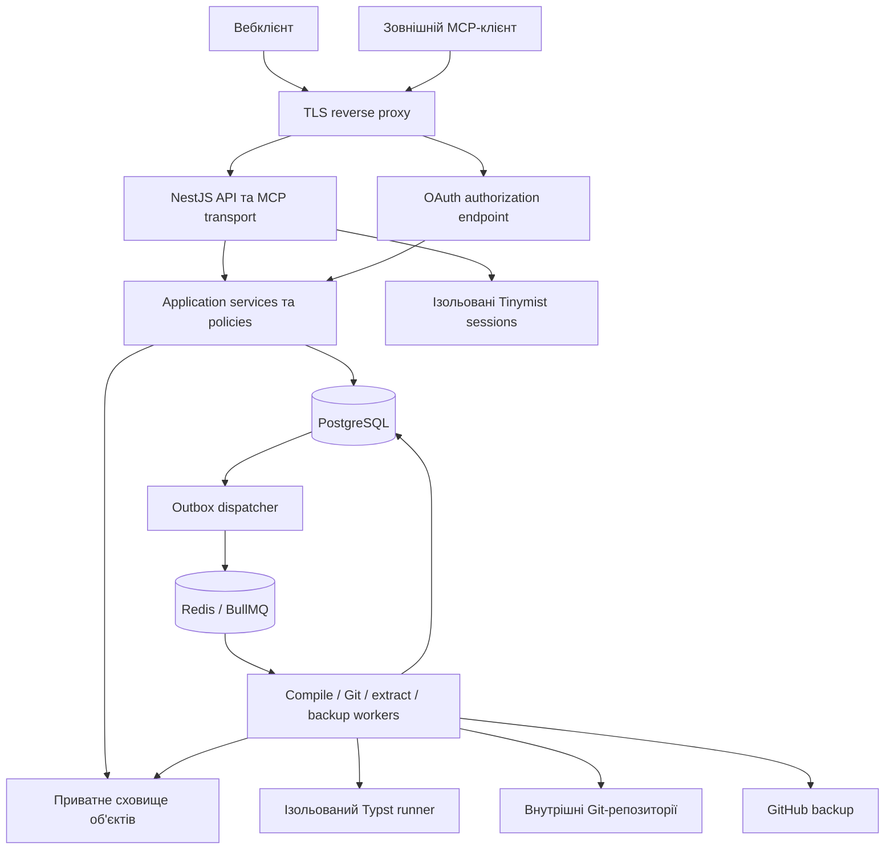

# Архітектура та технології

Статус: v0.1, 18.10.2026. TypeScript + NestJS, TypeORM, Swagger та локальний Docker лише для БД погоджено. Початковий каркас реалізовано; його фактичний стан описано у файлі 09. Інші компоненти нижче описують цільову систему й перевіряються до відповідних інкрементів.

## 1. Загальна структура

Модульний моноліт в одному репозиторії з окремими процесами API та фонових workers. Доменної логіки в MCP-контролерах і HTTP-контролерах немає: обидва викликають ті самі application services із явно переданим actor та дозволами.



MCP — окремий транспорт і набір схем усередині API-процесу. SDK підключається як HTTP handler з урахуванням його lifecycle; не пишемо власну реалізацію JSON-RPC. Якщо інтеграція SDK з NestJS потребуватиме іншого процесу, він використовуватиме той самий application package та policy layer; відділення не повинно породити другу бізнес-логіку.

## 2. Запропонований стек

| Частина  | Вибір                                                    | Причина та межі                                                                                            |
| -------- | -------------------------------------------------------- | ---------------------------------------------------------------------------------------------------------- |
| Runtime  | Підтримувана Node.js LTS, TypeScript strict              | Одна мова бекенду; точні версії зафіксувати на початку реалізації                                          |
| API      | NestJS, початково Express adapter                        | Простіша інтеграція HTTP handler SDK, OpenAPI, guards; Fastify не потрібен без виміряної потреби           |
| БД       | PostgreSQL + TypeORM                                     | Транзакції, міграції, типізований доступ; спеціальні блокування/constraints за потреби через SQL           |
| Черги    | BullMQ + Redis                                           | Інтеграція NestJS та окремі workers; БД зберігає доменний стан задач                                       |
| Файли    | Приватний S3-compatible storage                          | Незмінні blobs, PDF, архіви; локальний adapter допустимий для розробки                                     |
| Git      | Встановлений Git CLI через `spawn` із масивом аргументів | Справжня Git-історія; контрольований wrapper без shell і користувацьких hooks                              |
| Typst    | Зафіксований CLI у runner image                          | PDF з точних входів, явні шрифти й пакети                                                                  |
| Редактор | Tinymist як зовнішній LSP-процес                         | Completion, format, symbols, definitions; ізоляція та обмеження життєвого циклу                            |
| MCP      | Офіційний TypeScript SDK v2                              | Streamable HTTP, tools/resources, OAuth-сумісність; exact release та client matrix зафіксувати після spike |
| OAuth    | Готова серверна бібліотека; кандидат `oidc-provider`     | Не реалізовувати протокол вручну; перевірити MCP discovery, resource та PKCE                               |
| Вебсесії | Один непрозорий Bearer access token, запис у PostgreSQL  | Відкликання й контроль сеансів; окремо від MCP credentials                                                 |
| Пошта    | Mailjet Send API v3.1 у всіх середовищах                 | Підтвердження email та reset password                                                                      |
| Тести    | Unit + API integration + real Typst/Git + MCP client     | Перевірки контрактів і життєвих циклів, а не лише mock-компілятора                                         |

NestJS офіційно підтримує BullMQ; Redis є його залежністю. Обраний підхід до черг спирається на [документацію NestJS](https://docs.nestjs.com/techniques/queues). Механізми транзакцій та перевірки версій описані в [TypeORM](https://typeorm.io/docs/advanced-topics/transactions/); конкретні інваріанти визначає наша модель, а не ORM.

## 3. Модулі NestJS

| Модуль            | Відповідальність                                               |
| ----------------- | -------------------------------------------------------------- |
| IdentityModule    | Користувачі, паролі, email verification/reset, вебсесії        |
| AccessModule      | PAT, OAuth grants, scopes, дозволені проєкти, відкликання      |
| ProjectsModule    | Власність, метадані, entrypoint, життєвий цикл проєкту         |
| FilesModule       | Шляхи, типи файлів, blobs, атомарні набори файлових змін       |
| RevisionsModule   | Незмінні маніфести, optimistic concurrency, відновлення        |
| HistoryModule     | Git-проєкція ревізій, історія та diff                          |
| CompilationModule | CompileJob, input manifest, артефакти, діагностика             |
| ProposalsModule   | Draft, кандидат, перевірка, review, accept/reject              |
| ContextModule     | Контекст, окремі матеріали, extraction/search                  |
| AnnotationsModule | Коментарі, прив'язки, active/resolved, reanchor                |
| TemplatesModule   | Системні та власні шаблони, версії, share links, копіювання    |
| EditorModule      | LSP sessions, outline, editor diagnostics/preview              |
| TransferModule    | ZIP import/export, формат маніфесту                            |
| BackupModule      | GitHub connection, односторонній push і журнал                 |
| McpModule         | SDK handlers, schemas, resources; виклики application services |
| JobsModule        | Outbox dispatcher, retries, reconciliation, cleanup            |
| AuditModule       | Події без секретів і повного тексту приватних документів       |

Кожен модуль має public services; прямий доступ одного контролера до таблиць іншого модуля заборонений архітектурною домовленістю. Не додаємо окремі абстракції для кожного поля або CRUD-запиту. Repository/adapter виділяється там, де є доменні правила чи зовнішня система.

## 4. Орієнтовна структура коду

```text
src/
  main.ts
  app.module.ts
  modules/
    projects/{http,application,domain,infrastructure}/
    files/
    revisions/
    proposals/
    compilation/
    identity/
    access/
    context/
    annotations/
    templates/
    history/
    editor/
    transfer/
    backup/
    mcp/
  infrastructure/
    database/
      data-source.ts
      database.options.ts
      migrations/
    {storage,queue,git,typst,mail}/
  common/{errors,actor,validation,logging}/
workers/
  compile.main.ts
  maintenance.main.ts
test/{integration,e2e,fixtures}/
templates/system/
deploy/
docs/backend/
```

Це схема майбутнього розміщення. Початкові модулі можна мати без усіх чотирьох підкаталогів, доки їхня складність цього не потребує.

## 5. Правила взаємодії

1. Actor містить `userId`, канал `web|mcp|system`, credential/grant ID, scopes і project allowlist. `userId` не береться з тіла запиту.
2. Сервіс перевіряє власність і дозволені операції навіть після transport guard.
3. Mutation створює незмінну ревізію; job бачить її ID, а не «поточні файли на диску».
4. PostgreSQL — джерело істини для поточного стану. Redis переносить роботу; Git є відновлюваною проєкцією історії, а blobs зберігають байти.
5. Queue-повідомлення надсилаються через transactional outbox. Між БД, Redis, Git і storage немає спільної транзакції.
6. Зміни стану й повідомлення для фронтенду формуються після commit. SSE повідомляє про подію; повторний GET повертає актуальний стан.
7. Обчислювальні операції, Git, ZIP і парсинг великих матеріалів не виконуються синхронно в HTTP request/event loop.

## 6. Що перевіряємо до детального коду

- Сумісність обраної версії MCP SDK і реальних клієнтів: PAT, OAuth, tools, resource PDF, версія протоколу.
- Інтеграцію OAuth provider з NestJS та спільною вебсесією.
- Runner: ізоляція мережі/файлів, примусовий timeout, контроль пам'яті, українські шрифти та контрольовані пакети.
- Tinymist: LSP поверх браузерного каналу, зіставлення позицій, кілька одночасних sessions, обчислювані заголовки.
- Узгодженість TypeORM-транзакції, outbox, Git writer та повторного прийняття proposal.

Якщо spike змінює бібліотеку або adapter, рішення записується у файлі 08 до початку залежної функції.
