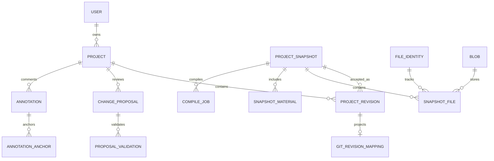

# Модель даних та узгодженість

Статус: проєктна модель v0.1. Identity та сутності початкового проєкту вже реалізовані в TypeORM; поточний сценарій описано у [12-project-creation.md](12-project-creation.md). Атомарні saves та staged uploads реалізовані; див. [13-atomic-text-changes.md](13-atomic-text-changes.md) і [14-resource-uploads.md](14-resource-uploads.md). Решта таблиці нижче описує цільовий домен і не означає наявності готових entities або API.

Поточний CompileJob зберігає також одне PDF blob-посилання з expiry та діагностику. Окрема CompileArtifact таблиця поки не потрібна для одного PDF; поля proposal/candidate нижче залишаються цільовими. Див. [15-compilation.md](15-compilation.md).

## 1. Основний принцип

У PostgreSQL зберігаються власність, доступи, поточна ревізія, незмінні маніфести та метадані. Байти файлів зберігаються у приватному storage як незмінні blobs. Git-коміти відтворюють послідовність прийнятих ревізій. Worker ніколи не читає спільну змінювану робочу папку проєкту.

Одна ревізія охоплює дерево файлів документа, entrypoint, текстовий контекст і версії контекстних матеріалів. Коментарі та їхній стан живуть окремо; їхня прив'язка містить конкретну ревізію. Зміна назви проєкту не створює нову версію документа; для title діє last-write-wins.

## 2. Сутності

Первинні та зовнішні ключі сутностей — додатні PostgreSQL `integer` з автоінкрементом для PK; в API це JSON numbers. Git hashes, OAuth client identifiers, requestId і випадкові секрети токенів залишаються рядками.

| Сутність                   | Основні поля та призначення                                                                                                                                                                 |
| -------------------------- | ------------------------------------------------------------------------------------------------------------------------------------------------------------------------------------------- |
| User                       | id integer auto-increment, normalizedEmail unique, passwordHash nullable (Google-only), googleSubject nullable unique, emailVerifiedAt, authVersion, timestamps                             |
| WebSession                 | userId, хеш випадкового session secret, authVersion, userAgent, expiresAt, revokedAt; серверна сесія                                                                                        |
| IdentityChallenge          | userId, kind verify/reset, tokenHash, expiresAt, consumedAt                                                                                                                                 |
| PersonalAccessToken        | userId, publicId, secretHash, name, scopes, expiresAt, revokedAt, lastUsedAt                                                                                                                |
| CredentialProjectGrant     | PAT/OAuth grant → дозволені projectId; загальний доступ до всіх проєктів лише за явним вибором                                                                                              |
| OAuthClient / OAuthGrant   | client metadata, user, scopes, project grants, timestamps, revokedAt                                                                                                                        |
| OAuth provider storage     | Codes, tokens, refresh families і consent через adapter бібліотеки; секрети не в довільних JSON-логах                                                                                       |
| Project                    | id, ownerId, title, currentRevisionId, nextRevisionNumber, deletedAt                                                                                                                        |
| FileIdentity               | id, projectId, createdAt; сталий ID логічного файла через перейменування                                                                                                                    |
| Blob                       | id, tenant ownerId, storageKey, sha256, sizeBytes, mediaType, createdAt                                                                                                                     |
| StagedUpload               | id, projectId, ownerId, blobId, filename, mediaType, expiresAt; повторно придатний reference                                                                                                |
| ProjectSnapshot            | id, projectId, mainFileId, contextText, manifestHash, createdAt; незмінний стан вмісту                                                                                                      |
| ProjectRevision            | id, projectId, number, parentRevisionId, snapshotId, actorId, channel, operation, summary, createdAt; прийнята версія                                                                       |
| SnapshotFile               | snapshotId, fileId, normalizedPath, blobId, contentKind, mediaType; дерево файлів документа                                                                                                 |
| ContextMaterial            | сталий ID матеріалу та projectId                                                                                                                                                            |
| SnapshotMaterial           | snapshotId, materialId, filename, blobId, description; версія прикріпленого джерела                                                                                                         |
| MaterialExtraction         | blobId, parserFingerprint, status, text/index object key, error; повторно використовуваний витяг                                                                                            |
| GitRevisionMapping         | revisionId unique, commitSha, parentSha, status pending/ready/failed, error, attempts                                                                                                       |
| CompileJob                 | id, projectId, snapshotId, revisionId?, proposalId?, candidateVersion?, inputManifestHash, compilerFingerprint, status, attempt, leaseToken, leaseUntil, timestamps, diagnostics, errorCode |
| CompileArtifact            | compileJobId, blobId, kind pdf/log, expiresAt                                                                                                                                               |
| ChangeProposal             | id, projectId, creatorCredentialId, baseRevisionId, candidateSnapshotId, version, status, summary, latestValidationId, acceptedRevisionId?                                                  |
| ProposalOperation          | proposalId, typed payload, targetFileId/materialId/annotationId, expected blob/hash; службове представлення diff                                                                            |
| ProposalValidation         | proposalId, candidateVersion, candidateManifestHash, structuralResult, compileJobId?, status, timestamps                                                                                    |
| Annotation                 | id, projectId, authorId, source web/mcp, body, status active/resolved, version                                                                                                              |
| AnnotationAnchor           | annotationId, fileId, revisionId, UTF-16 range, exactQuote, prefix, suffix, status attached/outdated/orphaned                                                                               |
| Template / TemplateVersion | ownerId? для системних, title, immutable snapshot manifest, entrypoint, approved included materials                                                                                         |
| TemplateShare              | templateVersionId, randomTokenHash, revokedAt, expiresAt?; capability лише на вибраний знімок                                                                                               |
| BackupConnection           | ownerId, GitHub installationId, repo ID, branch, includeContext, enabled                                                                                                                    |
| BackupRun                  | connectionId, projectId, revisionId, exported manifestHash, remoteCommitSha, status, errorCode                                                                                              |
| TransferJob                | import/export, userId, projectId?, input/output blob, status, validation report                                                                                                             |
| IdempotencyRecord          | actor credential/session family, route/tool, key, payloadHash, status, result pointer, expiresAt                                                                                            |
| AuditEvent                 | actor, credential ID, projectId?, action, targetId, requestId, outcome, timestamp                                                                                                           |

Candidate у proposal є ProjectSnapshot без номера прийнятої версії. Після редагування draft створюється новий snapshot; попередній не переписується. Прийняття створює ProjectRevision, що посилається на перевірений candidateSnapshotId.

Таким чином, ProjectSnapshot зберігає вміст, ProjectRevision — прийняття в основну історію, ChangeProposal — версію ще не прийнятого кандидата. У REST/MCP revisionId завжди означає прийняту версію; candidateSnapshotId повертається в proposal/validation. Це окремі типи ID, які не можна підмінити один одним для читання чужих або не прийнятих станів.

## 3. Зв'язки

## 4. Обмеження та індекси

- Числовий ID не замінює authorization. Кожен lookup вкладеного ресурсу перевіряє його зв'язок із projectId і власником.
- Unique `(projectId, number)` для прийнятих ревізій; unique `(snapshotId, normalizedPath)` та `(snapshotId, fileId)`.
- `mainFileId` належить до того самого snapshot і вказує на `.typ`. Видалити головний файл можна лише разом із вибором нового entrypoint у тій самій транзакції.
- `parentRevisionId`, candidate, annotation file, матеріали й proposal не можуть посилатися на інший проєкт. Де можливо — composite foreign keys; решта перевіряється транзакційно і тестами.
- Стан accepted вимагає `acceptedRevisionId`. Terminal CompileJob більше не змінює свої входи.
- Індекси: Project `(ownerId, deletedAt, updatedAt)`; Revision `(projectId, number)`; Proposal `(projectId, status, createdAt)`; CompileJob `(projectId, createdAt)`, `(status, leaseUntil)`; Audit `(projectId, createdAt)`.
- Дати у БД — UTC; зовнішній формат ISO 8601. Текст — UTF-8; довжини/ліміти файлів у байтах.
- Нормалізація email визначається одним правилом для реєстрації й входу. Case-insensitive uniqueness перевіряється в БД.

## 5. Атомарна зміна файлів

Збереження приймає `baseRevisionId` і набір операцій. Перед транзакцією нові байти перевіряються та пишуться як staging blobs. Потім коротка транзакція:

1. Перевіряє actor, active project і дозволи.
2. Блокує рядок Project або виконує compare-and-swap `currentRevisionId = baseRevisionId`.
3. Перевіряє шлях, типи, entrypoint, квоти та цілісність усього нового маніфесту.
4. Створює snapshot, зв'язки blobs та номер прийнятої версії.
5. Оновлює `currentRevisionId`, створює audit та pending Git mappings.
6. Commit повертає нову ревізію. Якщо база вже змінилася — `409 REVISION_CONFLICT`, жодна операція набору не застосована.

Blobs завантажуються до зміни currentRevision: БД не має посилатися на ще не записані байти. Після невдалої транзакції staging blobs прибере GC. Дедуплікація tenant scoped; API не розкриває, чи існує чужий hash.

Читання дерева, контексту та матеріалів приймає revisionId: MCP може читати послідовно, не змішуючи стани. Draft LSP містить ще не збережений текст і не змінює currentRevision.

## 6. Git без розподіленої транзакції

Цей сценарій реалізований: [16-git-history.md](16-git-history.md). Mapping має revision ID як PK, статус/commit/parent SHA, attempts, availableAt, lease token/expiry та безпечний error code.

На кожен проєкт — приватний bare repository. Git writer обробляє прийняті ревізії послідовно. Усередині commit є дерево документів і службовий manifest: сталі file IDs, entrypoint, контекст та матеріали. Користувач не може створити зарезервований шлях `.typstoria/` чи `.git/`.

Алгоритм writer:

1. Отримати lease проєкту; упевнитися, що батьківська ревізія вже має mapping.
2. Побудувати blobs/tree/commit із незмінного маніфесту. Автор, timestamp і message беруться з записаної ревізії, щоб повтор був детермінованим.
3. Оновити Git ref із перевіркою попереднього значення через `git update-ref`; поведінку визначає [документація Git](https://git-scm.com/docs/git-update-ref).
4. Записати mapping ready. Якщо процес упав після Git commit/ref, повтор знаходить той самий commit і дописує mapping.

Стан Git відображається окремо: `pending|ready|failed`. Невдалий Git writer не скасовує вже підтверджене збереження в PostgreSQL. Повторний writer/maintenance добудовує історію; API не повідомляє про успішний backup до завершення push. Поки mapping pending, diff можна отримати зі snapshot, явно повернувши `historySyncStatus`.

Git refs — проєкція; вони не визначають currentRevision всупереч БД. Відновлення ніколи не робить `reset --hard`: воно копіює обраний snapshot у нову прийняту ревізію.

## 7. Версія для PDF

Вхід компіляції визначається впорядкованим маніфестом **усіх файлів дерева документа**, entrypoint, хешем runner image, версіями Typst, пакетів, шрифтів і контрольованим значенням часу. Контекстні матеріали й анотації не монтуються в runner і не входять до compile hash.

У поточній реалізації `inputManifestHash` є повним snapshot hash, включно з context. `isCurrent` консервативно порівнює revision IDs: context-only зміна також позначає старий PDF неактуальним. Окремий compile-input cache/hash protocol зараз не вводиться.

Незбережений текст у редакторі — окрема ознака frontend `hasUnsavedChanges`; сервер не може заявляти відповідність такому тексту. Draft preview повертає draftVersion, а не статус authoritative compilation.

## 8. Retention та видалення

- Всі прийняті source revisions зберігаються до видалення проєкту; інакше історія не буде повною.
- Запропонована retention: PDF/log 7 днів, відхилені candidates 30 днів, audit 90 днів. Це налаштування, не погоджені строки з користувачем.
- Відсутній через retention PDF означає `artifactAvailable=false`; повторна компіляція доступна з історичного snapshot.
- Видалення проєкту спочатку ставить tombstone й одразу блокує доступи/нові jobs. Worker перед публікацією результату повторно перевіряє tombstone.
- Cleanup прибирає артефакти, Git repo, revisions і blobs після завершення/скасування jobs та перевірки всіх посилань, включно з незалежними шаблонами. Зовнішній GitHub backup не видаляється автоматично.
- Історію та storage не можна чистити тільки за віком blobs: перевіряються посилання accepted revisions, candidates, templates, jobs і backup/export jobs. Backup retention описана у файлі 06.
