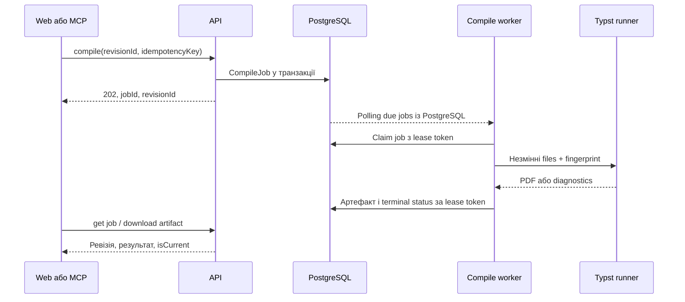

# Основні робочі процеси

Статус: проєктна поведінка v0.1. В усіх mutation перевіряються actor, project ownership, поточний стан та idempotency.

## 1. Створення й ручне редагування

Створення порожнього проєкту атомарно створює Project, `main.typ`, початкову ревізію та pending Git mapping. Шаблон копіюється з конкретної TemplateVersion; подальше редагування оригіналу не змінює копію.

Ручне збереження застосовує повний текст або атомарний набір файлових операцій із `baseRevisionId`. Неправильний Typst зберігається: структурна валідація проєкту й компіляція — різні операції. Збереження не означає успішного PDF.

При `409` frontend зберігає локальний текст, показує нову серверну ревізію та пропонує порівняння. Він не повторює той самий текст автоматично з новим baseRevisionId. Інша вкладка браузера підпадає під те саме правило.

## 2. Компіляція та PDF

Стани: `queued → running → succeeded|failed|timed_out|cancelled`. `failed` містить код `TYPST_ERROR|DEPENDENCY_UNAVAILABLE|RUNNER_UNAVAILABLE|OUTPUT_LIMIT|INTERNAL_ERROR`. Синтаксична помилка не є HTTP 500.

Worker створює нову робочу директорію з точного snapshot, окрему output directory та мінімальне середовище. Успіх — exit code 0, наявний непорожній валідний PDF у директорії поточної спроби та успішне збереження артефакту. Попередній PDF не може зробити нову невдалу задачу успішною.

Завершення не перезаписує «головний PDF» за спільним шляхом. Клієнт отримує artifact конкретного job. За відсутності нового результату можна показати попередній успішний PDF із позначкою ревізії та застарілості. Пізнє завершення старої задачі не змінює поточний результат новішої ревізії.

Ресурсний timeout завершує дерево процесів. Infrastructure failures мають обмежені retries; однаковий Typst error автоматично не повторюється. Після втрати worker lease reconciler повторює задачу або ставить terminal failure. Опублікувати результат може лише актуальна спроба з чинним lease token.

## 3. Робота ШІ через пропозицію

1. MCP-клієнт читає project overview і фіксує revisionId.
2. Читає потрібні файли, контекст, матеріали, анотації та структуру **цієї** ревізії.
3. Створює draft proposal з baseRevisionId, короткою метою й набором операцій.
4. Кожна зміна draft вимагає expectedProposalVersion і створює новий immutable candidate. Поточний проєкт залишається без змін.
5. Structural validation перевіряє шляхи, типи, квоти, entrypoint, посилання на файли. Для зміни compile inputs запускається компіляція candidate.
6. Користувач бачить diff усіх файлів, зміни контексту/матеріалів/анотацій, PDF або помилки та baseRevision.
7. Користувач приймає або відхиляє у вебінтерфейсі. MCP може читати статус і доопрацьовувати draft, але не приймати його.

Lifecycle proposal: `draft → accepted|rejected|expired`. Validation/compile result належить конкретній candidate version. Готовність, compile error та застаріла база виводяться з цих даних, не дублюються persisted status-ами. Structural checks виконуються при побудові candidate. Infrastructure compile failure не є успішною перевіркою.

Прийняття в одній короткій транзакції:

- Перевірити вебсесію власника; право MCP не підходить.
- Перевірити `expectedProposalVersion`, ID validation і точний candidateManifestHash.
- Перевірити currentRevisionId = baseRevisionId. Застаріла база → конфлікт; автоматичного merge немає.
- Для source/resource edits вимагати завершений compile результат цього candidate. `compile_failed` допускається лише з `acknowledgeCompileFailure=true` і явним попередженням користувачу. `invalid` та infrastructure `validation_failed` не приймаються як перевірені.
- Для context/annotation-only змін компіляція `not_required`; структурна валідація все одно обов'язкова.
- Створити accepted revision лише при зміні snapshot і застосувати annotation operations атомарно; змінити currentRevisionId; позначити acceptedRevisionId; записати audit/pending mapping.

Прийняття annotation-only proposal оновлює анотації та outcome proposal атомарно, без нової content revision/Git commit; анотації мають власні versions. Acceptance прив'язана до точної версії змін, а не до останнього вмісту «на момент натискання».

Повтор прийняття з тим самим idempotency key повертає той самий acceptedRevisionId. Нові candidate edits анулюють попередню validation. Два незалежні proposals можуть існувати одночасно, але після прийняття одного інший із тією самою базою стане stale.

## 4. Історія та відновлення

Історія показує авторство `web|mcp`, підсумок, номер версії, дату, зміни файлів та Git status. Для binary diff повертаються metadata/hashes, preview або download, а не текстовий patch.

Restore приймає targetRevisionId та expectedCurrentRevisionId. Він створює нову ревізію з файлами, entrypoint, контекстом і матеріалами вибраного стану. Старі версії не видаляються. Стан анотацій не переписується мовчки: запускається перевірка прив'язок, історичні anchors залишаються доступними.

## 5. Анотації та перейменування

Для anchor зберігаються fileId, revisionId, UTF-16 range для редактора, точний текст та сусідній контекст. Перейменування зберігає fileId. Після змін спочатку переносимо range за diff; потім шукаємо quote+context. Неоднозначний збіг → outdated/orphaned, а не довільне прикріплення до першого збігу.

Видалення файла не видаляє коментар автоматично; він залишається у списку з історичним фрагментом. Restore також перевіряє anchors. ШІ створює й змінює анотації через proposal; користувач може додавати та resolve вручну з перевіркою annotationVersion.

## 6. Контекстні матеріали

Upload створює blob і нову ревізію зв'язку з матеріалом. Заміна файла — нова версія, попередня залишається в історії. Витяг виконується worker, має parser fingerprint, status і ліміти.

MCP читає text chunks із provenance: materialId, blob hash, сторінка PDF або sheet/cell range. Це посилання на джерело, а не автоматичне визначення походження згенерованого документа. Пошук текстовий, із pagination і лімітами; vector database та embeddings не потрібні для цієї поставки.

## 7. Шаблони й поширення

Власник створює TemplateVersion із конкретної ревізії. До неї за замовчуванням входять лише source files, ресурси й entrypoint. Контекст/матеріали можна включити тільки явно у preview створення шаблону. Коментарі, proposals, credentials і вся попередня історія не копіюються.

Share link відкриває тільки зафіксований дозволений знімок. Перегляд метаданих/файлів знімка можливий за capability; створення власного проєкту вимагає входу. Доступ на редагування оригінального проєкту не надається. Відкликання зупиняє нові завантаження/копії, але не видаляє вже створені незалежні копії.

## 8. Імпорт/експорт

ZIP імпортується у staging, перевіряється повністю і лише потім створює новий проєкт. Підтримується Typstoria manifest з entrypoint; якщо manifest відсутній і є кілька можливих головних `.typ`, сервер повертає `ENTRYPOINT_REQUIRED`. Не вгадуємо мовчки.

Експорт має два явні профілі: `document` — джерела й ресурси; `project` — також контекст і матеріали з manifest. Обидва не містять credentials, OAuth state, proposals, коментарів та внутрішніх Git secrets. Повний disaster backup системи — інша процедура.

## 9. Зовнішній GitHub backup

GitHub connection прив'язана до користувача через GitHub App; власник обирає repository і виділену гілку. GitHub App credentials і MCP OAuth credentials — різні інтеграції.

Worker експортує accepted snapshot у резервну Git-історію: документ і ресурси; контекст/матеріали — згідно з явним includeContext. Увімкнення backup показує склад копії. Внутрішня Git-історія сервера продовжує існувати незалежно.

Операція одностороння, без force push та виконання remote hooks. Якщо remote branch змінилася стороннім способом, backup отримує conflict, повідомляє користувача і не тягне зміни у Typstoria. Retry не створює другого commit тієї самої ревізії. Розрив підключення зупиняє майбутні push, не видаляючи вже створені копії.

## 10. Редактор і структура

Бекенд керує окремими Tinymist sessions із tenant/project/session ID. Session може читати лише свою materialized workspace; unsaved changes містять documentVersion і не стають accepted revisions.

Completion/format/definition/diagnostics працюють через LSP proxy. Formatting повертає edits; застосування користувачем проходить звичайне збереження з baseRevision. Frontend не отримує URL чи port внутрішнього Tinymist.

Для початкового outline використовуємо syntax/LSP symbols і позиції у вихідному коді з revisionId/documentVersion. Computed headings можуть бути відсутні; окремий compiler-query pipeline додається за конкретної потреби. При помилковому документі outline може бути partial. Авторитетний PDF проходить CompileJob.
